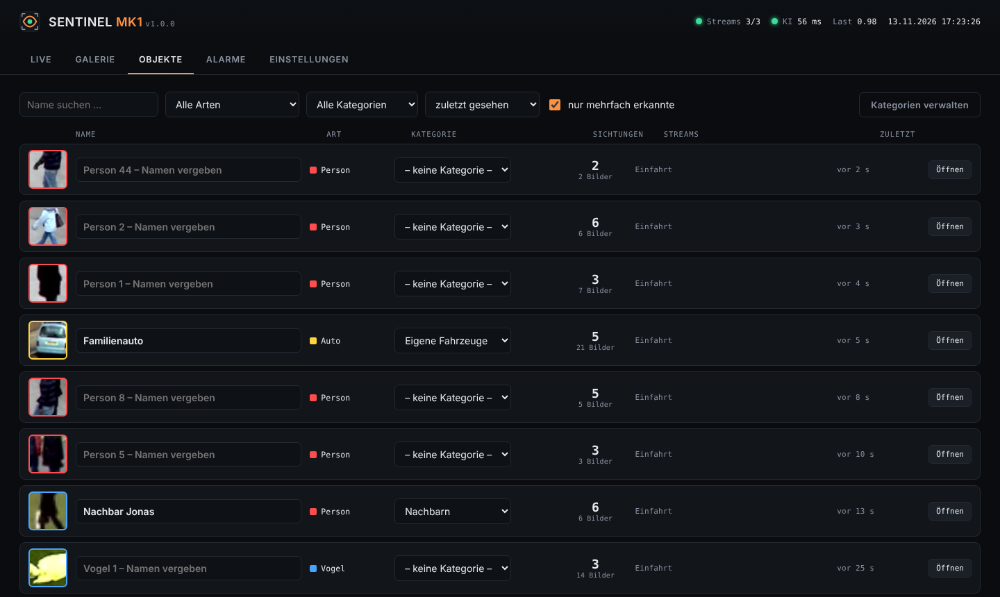

# Sentinel MK1

Objekterkennung für mehrere **RTSP-Kamerastreams** auf dem **NVIDIA Jetson Nano (2GB/4GB)** mit
GPU-Beschleunigung und Hardware-Videodekoder – im dunklen,
technischen Design der übrigen Dashboards. Personen, Tiere, Fahrzeuge usw. werden in jedem Stream
automatisch erkannt, farbig umrahmt, als Bild in einer Galerie gespeichert und **über alle Streams
hinweg wiedererkannt**. Personen werden einzeln identifiziert (Gesicht + Aussehen), Korrekturen
verbessern die nächste Zuordnung, und Alarmregeln melden, wenn z. B. dieselbe Person mehrfach
auftaucht.

**Version: 2.3.1** · Web-Port **8096** · läuft komplett lokal, keine Cloud


## Funktionen

- **Mehrere RTSP-Streams** gleichzeitig (auch HTTP/MJPEG oder Videodateien – alles, was ffmpeg öffnet).
  Pro Stream einstellbar: Bilder/s, Bildbreite, RTSP über TCP/UDP/automatisch, „nur Keyframes“ (spart Rechenleistung).
  „Testen“ prüft eine Kamera direkt vom Jetson aus (siehe *Kamera wird nicht angezeigt*).
- **Automatische Erkennung** (80 Arten, NanoDet-Plus) mit Rahmenfarben je Gruppe:

  | Gruppe | Farbe | Arten |
  |---|---|---|
  | Personen | 🔴 Rot | Person |
  | Tiere | 🔵 Blau | Vogel, Katze, Hund, Pferd, Schaf, Kuh, … |
  | Fahrzeuge | 🟡 Gelb | Auto, LKW, Bus, Motorrad |
  | Fahrräder | 🟢 Grün | Fahrrad |
  | Weitere Verkehrsmittel | 🟠 Orange | Flugzeug, Zug, Boot (aus) |
  | Taschen & Gepäck | 🟣 Violett | Rucksack, Handtasche, Koffer, Schirm (aus) |
  | Sonstige Gegenstände | ⚪ Grau | einzeln zuschaltbar |

- **Galerie:** von jedem erkannten Objekt wird ein Bild gespeichert (Vollbild + Ausschnitt) mit
  **Quell-Stream und Zeitstempel des Systems**; Filter nach Stream, Art, Kategorie, Tag.
  Bei längerer Anwesenheit optional weitere Bilder (Standard alle 120 s).
- **Objekt-Datenbank über alle Streams:** Wird ein Objekt mehrmals erkannt, erscheint es in der
  Liste **„Objekte“** – dort Namen vergeben und in **selbst angelegte Kategorien** einsortieren
  (z. B. Familie, Nachbarn, Lieferdienst, Eigene Fahrzeuge).
- **Personen einzeln identifizieren:** Gesicht finden (YuNet) und vergleichen (SFace, 128-dim.
  Merkmal). Ohne sichtbares Gesicht wird über Kleidung/Farben zugeordnet (zeitlich begrenzt,
  Standard 12 h). Taucht das Gesicht später auf, wird die Sichtung automatisch umgebucht.
- **Fehlzuordnungen korrigieren – das System lernt:** Bild (oder ganze Sichtung) einem anderen
  oder einem neuen Objekt zuordnen, mehrere Bilder auf einmal verschieben, Objekte zusammenführen.
  Die Merkmale werden beim richtigen Objekt als feste Beispiele und beim falschen als
  **Gegenbeispiele** gespeichert – die nächste Erkennung ordnet entsprechend besser zu.

  

- **Alarme:** Regeln für eine Art/Gruppe, eine Kategorie, ein bestimmtes Objekt oder alle Objekte,
  z. B. *„dieselbe Person ≥ 3× in 30 min in mindestens 2 Streams“* oder *„unbekannte Person …“*.
  Zählweise je Objekt einzeln oder gesamt, Pause nach Alarm. Meldung in der Oberfläche (mit Ton),
  per **MQTT** (`sentinel/alarm`) und/oder **Webhook** (JSON per POST).
- Live-Ansicht: flüssiges Live-Bild oder exakt das analysierte Bild, Vollbild per Doppelklick,
  Klick auf einen Rahmen öffnet das Objekt. iPhone/iPad-tauglich.
- **Bewegungsfilter:** ruhige Szenen werden nicht analysiert (spart Rechenzeit).
- **Speicherverwaltung:** Bilder nach x Tagen bzw. ab x MB automatisch löschen – gelernte
  Personen/Objekte bleiben erhalten.
- Alle Einstellungen in `config.json` (gut lesbar), Daten in `data/` – beides bleibt bei Updates erhalten.



## Installation auf dem NVIDIA Jetson Nano 2GB

Ein Skript richtet alles ein und nutzt die Hardware des Jetson:

| Aufgabe | läuft auf |
|---|---|
| Video dekodieren (H.264/H.265) + verkleinern | **NVDEC + VIC** (Hardware, `nvv4l2decoder` / `nvvidconv`) |
| Objekterkennung NanoDet (416 px) | **GPU, TensorRT FP16** |
| Gesichtsmerkmale SFace | **GPU, TensorRT FP16** |
| Gesichtssuche, Verfolgung, Datenbank, Weboberfläche | 4 CPU-Kerne |
| Live-Bild / Galerie-JPEGs | OpenCV, nur bei Bedarf |

Voraussetzung: JetPack 4.6 (L4T R32.7, Ubuntu 18.04) – das Standard-Image des Jetson Nano 2GB.

```sh
# ZIP auf den Jetson kopieren und dort:
unzip -o Sentinel-MK1.zip && sudo bash Sentinel-MK1/install-jetson.sh

# oder direkt von GitHub:
wget -O /tmp/install-jetson.sh https://raw.githubusercontent.com/Scorch1262/Sentinel-MK1/main/install-jetson.sh
sudo bash /tmp/install-jetson.sh
```

`install-jetson.sh` erledigt:

1. Pakete per `apt`: numpy, ffmpeg, GStreamer (rtsp, h264/h265-Parser), OpenBLAS; prüft OpenCV und TensorRT aus JetPack
2. 4 GB Auslagerungsdatei, falls weniger als 3 GB Swap vorhanden (nötig für den Engine-Bau beim 2-GB-Modell)
3. Programm nach **`/opt/Sentinel-MK1`** (`config.json` und `data/` bleiben erhalten)
4. KI-Modelle laden und daraus einmalig die **TensorRT-Engines** bauen (FP16, insgesamt ca. 5–20 min)
5. Leistungsmodus MAXN (`nvpmodel -m 0`)
6. Fragt, ob die grafische Oberfläche abgeschaltet werden soll (spart 0,5–0,8 GB RAM – beim 2-GB-Modell empfohlen)
7. systemd-Dienst **`sentinel`** mit Autostart, ggf. ufw-Regel

| Befehl | Wirkung |
|---|---|
| `sudo bash install-jetson.sh` | installieren / aktualisieren |
| `… --ohne-desktop` / `--mit-desktop` | grafische Oberfläche aus / wieder an (ab Neustart) |
| `… --maxtakt` | bei jedem Start `jetson_clocks` (höchste Taktraten, Lüfter empfohlen) |
| `… --port 8096` / `--ohne-swap` | Port setzen / keine Auslagerungsdatei |
| `sudo bash install-jetson.sh uninstall` | Dienst entfernen (Daten bleiben in `/opt/Sentinel-MK1`) |
| `journalctl -u sentinel -f` | Protokoll |
| `sudo systemctl restart sentinel` | Neustart |

### Lüfter

Ist am 4-Pin-Lüfteranschluss des Jetson ein Lüfter angeschlossen, regelt Sentinel ihn selbst
(**Einstellungen → Lüfter**). Die Jetson-Standardregelung startet den Lüfter erst spät; bei der
Dauerlast durch die Objekterkennung wird das Modul sonst heiß und taktet herunter.

| Einstellung | Standard |
|---|---|
| Aus unter | 32 °C (Lüfter läuft nach, bis die Temperatur darunter fällt) |
| Start bei | 38 °C mit 31 % |
| Voll bei | 62 °C mit 100 % |
| Notbetrieb | ab 75 °C immer 100 % |

- Maßgeblich ist die höchste Temperatur von CPU, GPU und der Schätzung des Jetson.
- Weitere Betriebsarten: *Jetson-Standardregelung*, *feste Drehzahl*, *immer volle Drehzahl*.
- **Anlaufhilfe:** viele 5-V-Lüfter starten bei kleinem Tastgrad nicht – sie laufen 1 s voll an.
- Die Drehzahl wird in kleinen Schritten gesenkt (kein ständiges Auf und Ab).
- Kopfzeile: Lüfter in % (U/min bei Lüftern mit Tachosignal). Beim Beenden von Sentinel übernimmt
  wieder die Jetson-Standardregelung.
- Mit `--maxtakt` setzt `jetson_clocks` den Lüfter beim Start kurz auf voll; danach regelt Sentinel.

Die Kopfzeile zeigt auf dem Jetson zusätzlich GPU-Auslastung, Temperatur und RAM. Unter
**Einstellungen → System** stehen Gerät, TensorRT-Version, Video-Dekoder und der Zustand der
GPU-Engines. Fehlen die Engines (z. B. nach einem JetPack-Update), baut Sentinel sie im
Hintergrund neu und rechnet bis dahin auf der CPU. Liefert der Hardware-Dekoder für einen Stream
keine Bilder, wechselt dieser Stream automatisch zu ffmpeg; je Stream ist der Dekoder auch fest
wählbar (Einstellungen → Streams).

Richtwerte Jetson Nano: NanoDet mit TensorRT FP16 ca. 20–40 ms je Bild (statt etwa 1 s auf der
CPU), dazu bis zu 8 × 1080p30-H.264 im Hardware-Dekoder. Damit sind auch Hauptstreams und 4–6
Kameras mit je 2–5 Bildern/s möglich. *Diese Werte sind Erfahrungswerte, auf dem Gerät noch nicht
gemessen – der echte Wert steht in der Kopfzeile unter „KI“.*

## Updates über GitHub

Unter **Einstellungen → System → Updates (GitHub)** zeigt Sentinel die installierte und die neueste
Version im Repo [Scorch1262/Sentinel-MK1](https://github.com/Scorch1262/Sentinel-MK1) samt
Änderungen aus `CHANGELOG.md`. **„Update installieren“** lädt die neue Version, sichert die laufende
nach `data/backup/v<version>/`, kopiert die Programmdateien und startet neu – `config.json`,
Datenbank, Bilder, Modelle und GPU-Engines bleiben unverändert. Ist eine neue Version da, erscheint
oben in der Kopfzeile ein Hinweis (automatische Prüfung alle 6 Stunden, abschaltbar).

- **Sicher:** Vor der Installation werden alle Python-Dateien der neuen Version auf Syntaxfehler
  geprüft. Startet die neue Version zweimal hintereinander nicht, spielt Sentinel beim dritten Start
  automatisch die Sicherung zurück (Hinweis unter Updates).
- **Download:** zuerst das Archiv des Zweigs (`codeload.github.com`), sonst Einzeldateien über
  `raw.githubusercontent.com` mit der Dateiliste der GitHub-API bzw. der Datei `MANIFEST` im Repo.
- **Neue Version veröffentlichen:** im Repo `VERSION` **und** `VERSION = "…"` in `app.py` erhöhen,
  einen Abschnitt `## x.y.z` in `CHANGELOG.md` ergänzen und bei neuen Dateien `MANIFEST` erweitern.
  Optional führt eine `update_hook.py` im Repo nach dem Kopieren zusätzliche Schritte aus
  (Aufruf: `python3 update_hook.py <alte> <neue Version>`).
- Repo und Zweig sind einstellbar (z. B. ein Test-Zweig). Für ein privates Repo einen GitHub-Token in
  `data/github_token` ablegen. Ältere Versionen werden nicht installiert (kein Downgrade).

## Erkennungsqualität

| Modell | Eingang | Genauigkeit (COCO mAP) | empfohlen für |
|---|---|---|---|
| YOLOX-M | 640 px | 46,9 | Jetson-GPU, höchste Genauigkeit, ca. 3× langsamer – 1–2 Kameras |
| **YOLOX-S** | 640 px | 40,5 | Jetson-GPU (Standard dort) |
| YOLOX-Tiny | 416 px | 32,8 | ohne GPU (Standard dort), mehr Kameras |
| NanoDet-Plus | 320/416 px | 30,4 | am schnellsten; Übergang, solange die YOLOX-Engine gebaut wird |

Ohne GPU (oder solange die TensorRT-Engines gebaut werden) rechnet Sentinel mit einer eigenen,
schlanken KI-Laufzeit auf der CPU (`sentinel/onnxlite.py`, nur numpy, Ergebnisse identisch zu
onnxruntime) – deutlich langsamer, aber ohne Ausfall.

### Weit entfernte und kleine Objekte

Das Modell sieht jedes Bild auf seine Eingangsgröße verkleinert (640 px). Eine Person, die im
Kamerabild 40 px hoch ist, hat danach oft nur noch 20 px – zu wenig. Zwei Hebel helfen:

1. **Höhere Analyse-Auflösung** – im Stream die **Breite auf 1280** stellen und, wenn möglich,
   den **Hauptstream** der Kamera statt des Substreams (oft nur 640×480 oder 704×576) eintragen.
   NVDEC dekodiert auch 1080p ohne CPU-Last.
2. **Kachel-Analyse** (Standard mit GPU) – zusätzlich zum ganzen Bild werden 2–4 überlappende
   Ausschnitte in voller Auflösung geprüft und die Ergebnisse zusammengeführt; am Kachelrand
   abgeschnittene Objekte werden wieder zusammengesetzt. Kostet je Kachel eine weitere Analyse
   (Anzeige unter System: „… Durchläufe inkl. Kacheln“).

Der **Bewegungsfilter** misst jetzt die bewegte Fläche gegenüber dem Hintergrundbild statt des
mittleren Bildunterschieds. Früher konnte eine kleine Person in einem sonst ruhigen Bild bis zu
30 s übersehen werden, weil sie den Mittelwert kaum verändert.

**Google Coral?** Ein Coral-USB-Stick bringt am Jetson keine bessere Erkennung: Über USB laufen
nur kleine INT8-Modelle (bestes: EfficientDet-Lite2, 36 % mAP, ca. 100 ms), also ungenauer als
YOLOX-S (40,5 %) auf der Jetson-GPU. Er lohnt sich für Rechner ohne GPU (z. B. Raspberry Pi).

### Fehltreffer

Gegen Fehltreffer (z. B. „Personen“ in Autoschatten) arbeiten mehrere Stufen zusammen:

1. **Mindest-Sicherheit je Gruppe** – Personen standardmäßig 55 %, andere 50 %.
2. **Formprüfung** – eine Person muss mindestens 0,9× so hoch wie breit sein. Flache Treffer wie
   Schatten zählen nur bei sehr hoher Sicherheit.
3. **3 Treffer in Folge** und ein ausreichender Mittelwert, bevor etwas als Sichtung gilt.
4. **Bewegungspflicht** – neue Personen, Tiere und Fahrräder zählen erst, wenn sich an der Stelle
   etwas bewegt (Vergleich mit einem Hintergrundbild je Kamera). Stehende Schatten parkender Autos,
   Plakate oder Statuen werden so nie gemeldet. Je Gruppe abschaltbar.
5. **Zweitprüfung** – der Bereich um ein neues Objekt wird vergrößert ein zweites Mal analysiert;
   Schatten, Spiegelungen und Muster bestehen das meist nicht.
6. **Gelernte Fehlerkennungen** – in der Galerie bei einem falschen Treffer **„Fehlerkennung“**
   (oder beim Objekt „Ist Fehlerkennung“) wählen. Sentinel merkt sich Ort und Aussehen je Stream
   und meldet dort so etwas nicht mehr. Liste und Löschen unter Einstellungen.

Im Live-Bild erscheinen nur noch bestätigte Objekte. Unter Einstellungen → Objekterkennung zeigt
„Verworfen“, wie oft jede Stufe seit dem Start eingegriffen hat.

## Kamera wird nicht angezeigt

Unter **Einstellungen → Streams** hat jeder Stream den Knopf **Testen**. Der Jetson prüft dann
selbst Schritt für Schritt: Ist die Kamera erreichbar, was antwortet sie auf RTSP
(z. B. `401` = Passwort falsch, `404` = Pfad falsch, `503` = Kamera noch nicht bereit),
kommen Videodaten über **TCP** und über **UDP** an, und erkennt ffprobe das Bild.
Der rot markierte Schritt zeigt, woran es hängt; passt ein anderer Transport, gibt es
eine Empfehlung zum Übernehmen.

**RTSP: automatisch** (Standard) verbindet zuerst über TCP und wechselt auf UDP, wenn die
Kamera darüber keine Bilder liefert – so wie VLC, das standardmäßig UDP nutzt. Läuft ein
Stream in VLC, aber nicht in Sentinel, liegt es meist genau daran. Welcher Weg gerade
genutzt wird, steht unter dem Stream („Aktiv: … RTSP UDP (auto)“).

Weitere Ursachen: Manche Kameras erlauben nur wenige gleichzeitige Verbindungen – offene
VLC-Fenster schließen. Bei UDP muss der Jetson die Kamera ohne NAT erreichen (gleiches Netz).

## Personen anlegen und Erkennungen zuweisen

- **Person anlegen:** Objekte → **„+ Person anlegen“** (Name, Art, Kategorie). Danach öffnet sich
  direkt die Bildauswahl: passende Bilder anklicken → **„… zuweisen“**.
- **Beim Objekt:** **„+ Erkennungen zuweisen“** zeigt alle noch nicht zugewiesenen Bilder der
  passenden Art (Filter: Stream, auch bereits anderen zugewiesene).
- **In der Galerie:** **„Auswählen“** → Bilder anklicken → unten *Zuweisen an …* (oder *Neue Person
  anlegen*), *Fehlerkennung* oder *Löschen*. Filter **„nur noch nicht zugewiesene“** zeigt, was
  noch offen ist.
- **Einzelnes Bild:** im Bild-Dialog unter **„Wer ist das? Zuweisen“**.
- Jede Zuweisung ist Lernstoff: Die Merkmale zählen künftig für die gewählte Person und als
  Gegenbeispiel für die bisherige. Bilder mit sichtbarem Gesicht helfen am meisten.
- Bilder einer anderen Art (z. B. ein Auto in eine Person) werden beim Zuweisen übersprungen.

**Alles löschen:** Galerie → **„Alles löschen“** (oder Einstellungen → Speicher). Löscht alle
Erkennungen und Bilder; wahlweise auch alle Personen/Objekte samt Gelerntem, die gelernten
Fehlerkennungen und den Alarmverlauf. Zur Sicherheit muss „LÖSCHEN“ eingetippt werden.

## Wie die Wiedererkennung funktioniert

1. Ein Objekt zählt als **Sichtung**, sobald es mehrmals hintereinander erkannt wurde
   (Standard 2×). Eine durchgehende Anwesenheit zählt einmal; erst nach 60 s Abwesenheit im selben
   Stream zählt eine neue Sichtung.
2. Für jede Sichtung werden Merkmale gebildet: bei Personen Gesicht (falls ≥ 28 px sichtbar) und
   Aussehen (Farbverteilung in drei Bereichen), bei allen anderen das Aussehen.
3. Vergleich mit allen bekannten Objekten derselben Art – **egal aus welchem Stream**. Passt keins,
   wird ein neues Objekt angelegt („Person 17“, „Auto 3“ …).
4. Korrekturen und Zusammenführungen werden als feste Beispiele bzw. Gegenbeispiele gespeichert.

Schwellen (Gesicht 0,40 · Aussehen 0,90 · Zeitfenster) sind unter **Einstellungen → Wiedererkennung**
anpassbar. Fahrzeuge und Tiere werden nur über ihr Aussehen (Farbe) unterschieden – gleichfarbige
Autos lassen sich dadurch nicht sicher auseinanderhalten; Kennzeichenerkennung gibt es nicht.

## MQTT

| Topic | Inhalt |
|---|---|
| `sentinel/alarm` | `{"alarm": "...", "object": "Max", "object_id": 7, "cls": "person", "count": 3, "streams": ["Einfahrt","Hof"], "text": "...", "time": "2026-11-13 17:20:00"}` |
| `sentinel/detection` | jede Sichtung (optional, Einstellungen → MQTT) |
| `sentinel/test` | Testnachricht |

Präfix `sentinel` ist änderbar.

## Dateien

```
app.py                 Start (python3 app.py [--port 8096] [--host 0.0.0.0] [--data ORDNER])
install-jetson.sh      Installer für NVIDIA Jetson Nano (apt, TensorRT-Engines, systemd)
requirements.txt       numpy
VERSION
sentinel/
  engine.py            Streams, Analyse, Verfolgung, Wiedererkennung, Alarme, Aufräumen
  detector.py          YOLOX / NanoDet (Objekte), YuNet (Gesichter), SFace (Gesichtsmerkmale)
  trt.py               TensorRT-Ausführung auf der Jetson-GPU (CUDA per ctypes, ohne pycuda)
  sysinfo.py           Geräteerkennung, GPU-Last, Temperatur, RAM
  fan.py               Lüfterregelung für den Jetson (PWM-Kurve)
  onnxlite.py          CPU-Rückfall: KI-Laufzeit nur mit numpy (ONNX-Leser + Operatoren)
  streams.py           Empfang per GStreamer mit Hardware-Dekoder (NVDEC), Rückfall ffmpeg
  streamtest.py        Stream-Test: Netzwerk, RTSP-Antworten, Empfang über TCP und UDP
  store.py             SQLite-Datenbank
  web.py               Webserver + JSON-API
  updater.py           Updates aus dem GitHub-Repo (Sicherung, Installation, Neustart)
  imaging.py, models.py, mqtt.py, config.py
static/                Weboberfläche (HTML/CSS/JS)
docs/                  Bilder für diese Anleitung
CHANGELOG.md           Änderungen je Version (wird beim Update angezeigt)
MANIFEST               Dateiliste für Updates ohne Archiv-Download
```

Laufzeitdaten (nicht im Repo): `config.json`, `data/sentinel.db`, `data/snaps/JJJJ-MM-TT/`,
`data/avatars/`, `data/models/`, `data/backup/` (Sicherungen vor Updates).

Am PC testen: `pip install numpy` und ffmpeg installieren, dann `python3 app.py`
(ist OpenCV installiert, wird es für die Objekterkennung automatisch genutzt).

## Hinweis Datenschutz

Gesichtsmerkmale sind biometrische Daten. Kameras nur auf eigenem Grundstück betreiben, keine
öffentlichen Flächen oder Nachbargrundstücke erfassen, Betroffene informieren und die
Aufbewahrungsdauer (Einstellungen → Speicher) knapp halten.

## Lizenz

MIT (siehe `LICENSE`). KI-Modelle aus dem [OpenCV Model Zoo](https://github.com/opencv/opencv_zoo):
NanoDet-Plus (Apache-2.0), YOLOX (Apache-2.0, Megvii), YuNet (MIT), SFace (Apache-2.0) – werden bei der Installation geladen,
nicht mitgeliefert.
