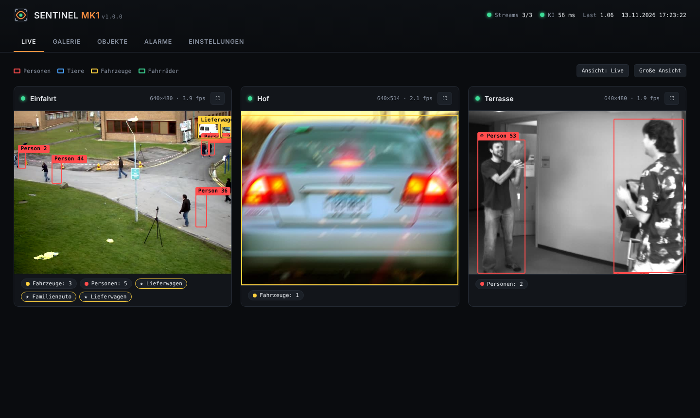

# Sentinel MK1

Objekterkennung für mehrere **RTSP-Kamerastreams** auf dem **NVIDIA Jetson Nano (2GB/4GB)** mit
GPU-Beschleunigung und Hardware-Videodekoder – im dunklen,
technischen Design der übrigen Dashboards. Personen, Tiere, Fahrzeuge usw. werden in jedem Stream
automatisch erkannt, farbig umrahmt, als Bild in einer Galerie gespeichert und **über alle Streams
hinweg wiedererkannt**. Personen werden einzeln identifiziert (Gesicht + Aussehen), Korrekturen
verbessern die nächste Zuordnung, und Alarmregeln melden, wenn z. B. dieselbe Person mehrfach
auftaucht.

**Version: 2.9.0** · Web-Port **8096** · läuft komplett lokal, keine Cloud



## Funktionen

- **Mehrere RTSP-Streams** gleichzeitig (auch HTTP/MJPEG oder Videodateien – alles, was ffmpeg öffnet).
  Pro Stream einstellbar: Bilder/s, Bildbreite, RTSP über TCP/UDP/automatisch, „nur Keyframes“ (spart Rechenleistung).
  „Testen“ prüft eine Kamera direkt vom Jetson aus (siehe *Kamera wird nicht angezeigt*).
- **Analyse je Stream wählbar:** *Objekterkennung (KI)*, *nur Bewegung* (ohne KI – braucht kaum
  Rechenleistung) oder *aus* (nur Live-Bild).
- **Videoschnipsel je Stream:** Aufnahme *bei Bewegung* oder *bei erkanntem Objekt*, Länge
  einstellbar, auf Wunsch verlängert, solange sich etwas bewegt (mit Höchstlänge). Ansehen und
  herunterladen im Tab **Ereignisse** (siehe *Bewegung und Videoaufnahmen*).
- **Speicherort wählbar:** Bilder und Videos im Datenordner, auf einer **USB-Festplatte** oder auf
  einem **Netzwerkspeicher** (SMB/NFS – NAS, Windows-Freigabe, Fritzbox); freier Platz aller
  Speicherorte als Balken, wahlweise Loop-Betrieb.
- **MQTT je Stream** (Bewegung, Aufnahme, erreichbar, Personen …) und **Speicherfüllstand** jede Sekunde.
- **Automatische Erkennung** (80 Arten, NanoDet-Plus) mit Rahmenfarben je Gruppe:

  | Gruppe | Farbe | Arten |
  |---|---|---|
  | Personen | 🔴 Rot | Person |
  | Tiere | 🔵 Blau | Vogel, Katze, Hund, Pferd, Schaf, Kuh, … |
  | Fahrzeuge | 🟡 Gelb | Auto, LKW, Bus, Motorrad |
  | Fahrräder | 🟢 Grün | Fahrrad |
  | Weitere Verkehrsmittel | 🟠 Orange | Flugzeug, Zug, Boot (aus) |
  | Taschen & Gepäck | 🟣 Violett | Rucksack, Handtasche, Koffer, Schirm (aus) |
  | Sonstige Gegenstände | ⚪ Grau | einzeln zuschaltbar |

- **Galerie:** von jedem erkannten Objekt wird ein Bild gespeichert (Vollbild + Ausschnitt) mit
  **Quell-Stream und Zeitstempel des Systems**; Filter nach Stream, Art, Kategorie, Tag.
  Bei längerer Anwesenheit optional weitere Bilder (Standard alle 120 s).
- **Objekt-Datenbank über alle Streams:** Wird ein Objekt mehrmals erkannt, erscheint es in der
  Liste **„Objekte“** – dort Namen vergeben und in **selbst angelegte Kategorien** einsortieren
  (z. B. Familie, Nachbarn, Lieferdienst, Eigene Fahrzeuge).
- **Personen einzeln identifizieren:** Gesicht finden (YuNet) und vergleichen (SFace, 128-dim.
  Merkmal). Ohne sichtbares Gesicht wird über Kleidung/Farben zugeordnet (zeitlich begrenzt,
  Standard 12 h). Taucht das Gesicht später auf, wird die Sichtung automatisch umgebucht.
- **Fehlzuordnungen korrigieren – das System lernt:** Bild (oder ganze Sichtung) einem anderen
  oder einem neuen Objekt zuordnen, mehrere Bilder auf einmal verschieben, Objekte zusammenführen.
  Die Merkmale werden beim richtigen Objekt als feste Beispiele und beim falschen als
  **Gegenbeispiele** gespeichert – die nächste Erkennung ordnet entsprechend besser zu.

  

- **Alarme:** Regeln für eine Art/Gruppe, eine Kategorie, ein bestimmtes Objekt oder alle Objekte,
  z. B. *„dieselbe Person ≥ 3× in 30 min in mindestens 2 Streams“* oder *„unbekannte Person …“*.
  Zählweise je Objekt einzeln oder gesamt, Pause nach Alarm. Meldung in der Oberfläche (mit Ton),
  per **MQTT** (`sentinel/alarm`) und/oder **Webhook** (JSON per POST).
- Live-Ansicht: flüssiges Live-Bild oder exakt das analysierte Bild, Vollbild per Doppelklick,
  Klick auf einen Rahmen öffnet das Objekt. iPhone/iPad-tauglich.
- **Bewegungsfilter:** ruhige Szenen werden nicht analysiert (spart Rechenzeit).
- **System-Monitor eingebunden:** [System-Monitor-MQTT-MK1](https://github.com/Scorch1262/System-Monitor-MQTT-MK1)
  sendet CPU, GPU, RAM, Temperaturen, Lüfter und Leistung des Jetson per MQTT – installieren,
  aktualisieren und **öffnen** unter Einstellungen → System-Monitor.
- **Gerät herunterfahren / neu starten** per Knopf unter Einstellungen → System (laufende
  Aufnahmen werden vorher abgeschlossen).
- **Speicherverwaltung:** Bilder und Videos nach x Tagen bzw. ab x MB automatisch löschen – gelernte
  Personen/Objekte bleiben erhalten.
- Alle Einstellungen in `config.json` (gut lesbar), Daten in `data/` – beides bleibt bei Updates erhalten.


## Installation auf dem NVIDIA Jetson Nano 2GB

Ein Skript richtet alles ein und nutzt die Hardware des Jetson:

| Aufgabe | läuft auf |
|---|---|
| Video dekodieren (H.264/H.265) + verkleinern | **NVDEC + VIC** (Hardware, `nvv4l2decoder` / `nvvidconv`) |
| Objekterkennung NanoDet (416 px) | **GPU, TensorRT FP16** |
| Gesichtsmerkmale SFace | **GPU, TensorRT FP16** |
| Gesichtssuche, Verfolgung, Datenbank, Weboberfläche | 4 CPU-Kerne |
| Live-Bild / Galerie-JPEGs | OpenCV, nur bei Bedarf |

Voraussetzung: JetPack 4.6 (L4T R32.7, Ubuntu 18.04) – das Standard-Image des Jetson Nano 2GB.

```sh
# ZIP auf den Jetson kopieren und dort:
unzip -o Sentinel-MK1.zip && sudo bash Sentinel-MK1/install-jetson.sh

# oder direkt von GitHub:
wget -O /tmp/install-jetson.sh https://raw.githubusercontent.com/Scorch1262/Sentinel-MK1/main/install-jetson.sh
sudo bash /tmp/install-jetson.sh
```

`install-jetson.sh` erledigt:

1. Pakete per `apt`: numpy, ffmpeg, GStreamer (rtsp, h264/h265-Parser), OpenBLAS; prüft OpenCV und TensorRT aus JetPack
2. 4 GB Auslagerungsdatei, falls weniger als 3 GB Swap vorhanden (nötig für den Engine-Bau beim 2-GB-Modell)
3. Programm nach **`/opt/Sentinel-MK1`** (`config.json` und `data/` bleiben erhalten)
4. KI-Modelle laden und daraus einmalig die **TensorRT-Engines** bauen (FP16, insgesamt ca. 5–20 min)
5. Leistungsmodus MAXN (`nvpmodel -m 0`)
6. Fragt, ob die grafische Oberfläche abgeschaltet werden soll (spart 0,5–0,8 GB RAM – beim 2-GB-Modell empfohlen)
7. systemd-Dienst **`sentinel`** mit Autostart, ggf. ufw-Regel

| Befehl | Wirkung |
|---|---|
| `sudo bash install-jetson.sh` | installieren / aktualisieren |
| `… --ohne-desktop` / `--mit-desktop` | grafische Oberfläche aus / wieder an (ab Neustart) |
| `… --maxtakt` | bei jedem Start `jetson_clocks` (höchste Taktraten, Lüfter empfohlen) |
| `… --port 8096` / `--ohne-swap` | Port setzen / keine Auslagerungsdatei |
| `sudo bash install-jetson.sh uninstall` | Dienst entfernen (Daten bleiben in `/opt/Sentinel-MK1`) |
| `journalctl -u sentinel -f` | Protokoll |
| `sudo systemctl restart sentinel` | Neustart |

### Lüfter

Ist am 4-Pin-Lüfteranschluss des Jetson ein Lüfter angeschlossen, regelt Sentinel ihn selbst
(**Einstellungen → Lüfter**). Die Jetson-Standardregelung startet den Lüfter erst spät; bei der
Dauerlast durch die Objekterkennung wird das Modul sonst heiß und taktet herunter.

| Einstellung | Standard |
|---|---|
| Aus unter | 32 °C (Lüfter läuft nach, bis die Temperatur darunter fällt) |
| Start bei | 38 °C mit 31 % |
| Voll bei | 62 °C mit 100 % |
| Notbetrieb | ab 75 °C immer 100 % |

- Maßgeblich ist die höchste Temperatur von CPU, GPU und der Schätzung des Jetson.
- Weitere Betriebsarten: *Jetson-Standardregelung*, *feste Drehzahl*, *immer volle Drehzahl*.
- **Anlaufhilfe:** viele 5-V-Lüfter starten bei kleinem Tastgrad nicht – sie laufen 1 s voll an.
- Die Drehzahl wird in kleinen Schritten gesenkt (kein ständiges Auf und Ab).
- Kopfzeile: Lüfter in % (U/min bei Lüftern mit Tachosignal). Beim Beenden von Sentinel übernimmt
  wieder die Jetson-Standardregelung.
- Mit `--maxtakt` setzt `jetson_clocks` den Lüfter beim Start kurz auf voll; danach regelt Sentinel.

Die Kopfzeile zeigt auf dem Jetson zusätzlich GPU-Auslastung, Temperatur und RAM. Unter
**Einstellungen → System** stehen Gerät, TensorRT-Version, Video-Dekoder und der Zustand der
GPU-Engines. Fehlen die Engines (z. B. nach einem JetPack-Update), baut Sentinel sie im
Hintergrund neu und rechnet bis dahin auf der CPU. Liefert der Hardware-Dekoder für einen Stream
keine Bilder, wechselt dieser Stream automatisch zu ffmpeg; je Stream ist der Dekoder auch fest
wählbar (Einstellungen → Streams).

Richtwerte Jetson Nano: NanoDet mit TensorRT FP16 ca. 20–40 ms je Bild (statt etwa 1 s auf der
CPU), dazu bis zu 8 × 1080p30-H.264 im Hardware-Dekoder. Damit sind auch Hauptstreams und 4–6
Kameras mit je 2–5 Bildern/s möglich. *Diese Werte sind Erfahrungswerte, auf dem Gerät noch nicht
gemessen – der echte Wert steht in der Kopfzeile unter „KI“.*

## Updates über GitHub

Unter **Einstellungen → System → Updates (GitHub)** zeigt Sentinel die installierte und die neueste
Version im Repo [Scorch1262/Sentinel-MK1](https://github.com/Scorch1262/Sentinel-MK1) samt
Änderungen aus `CHANGELOG.md`. **„Update installieren“** lädt die neue Version, sichert die laufende
nach `data/backup/v<version>/`, kopiert die Programmdateien und startet neu – `config.json`,
Datenbank, Bilder, Modelle und GPU-Engines bleiben unverändert. Ist eine neue Version da, erscheint
oben in der Kopfzeile ein Hinweis (automatische Prüfung alle 6 Stunden, abschaltbar).

- **Sicher:** Vor der Installation werden alle Python-Dateien der neuen Version auf Syntaxfehler
  geprüft. Startet die neue Version zweimal hintereinander nicht, spielt Sentinel beim dritten Start
  automatisch die Sicherung zurück (Hinweis unter Updates).
- **Download:** zuerst das Archiv des Zweigs (`codeload.github.com`), sonst Einzeldateien über
  `raw.githubusercontent.com` mit der Dateiliste der GitHub-API bzw. der Datei `MANIFEST` im Repo.
- **Neue Version veröffentlichen:** im Repo `VERSION` **und** `VERSION = "…"` in `app.py` erhöhen,
  einen Abschnitt `## x.y.z` in `CHANGELOG.md` ergänzen und bei neuen Dateien `MANIFEST` erweitern.
  Optional führt eine `update_hook.py` im Repo nach dem Kopieren zusätzliche Schritte aus
  (Aufruf: `python3 update_hook.py <alte> <neue Version>`).
- Repo und Zweig sind einstellbar (z. B. ein Test-Zweig). Für ein privates Repo einen GitHub-Token in
  `data/github_token` ablegen. Ältere Versionen werden nicht installiert (kein Downgrade).

## Erkennungsqualität

| Modell | Eingang | Genauigkeit (COCO mAP) | empfohlen für |
|---|---|---|---|
| YOLOX-M | 640 px | 46,9 | Jetson-GPU, höchste Genauigkeit, ca. 3× langsamer – 1–2 Kameras |
| **YOLOX-S** | 640 px | 40,5 | Jetson-GPU (Standard dort) |
| YOLOX-Tiny | 416 px | 32,8 | ohne GPU (Standard dort), mehr Kameras |
| NanoDet-Plus | 320/416 px | 30,4 | am schnellsten; Übergang, solange die YOLOX-Engine gebaut wird |

Ohne GPU (oder solange die TensorRT-Engines gebaut werden) rechnet Sentinel mit einer eigenen,
schlanken KI-Laufzeit auf der CPU (`sentinel/onnxlite.py`, nur numpy, Ergebnisse identisch zu
onnxruntime) – deutlich langsamer, aber ohne Ausfall.

### Weit entfernte und kleine Objekte

Das Modell sieht jedes Bild auf seine Eingangsgröße verkleinert (640 px). Eine Person, die im
Kamerabild 40 px hoch ist, hat danach oft nur noch 20 px – zu wenig. Zwei Hebel helfen:

1. **Höhere Analyse-Auflösung** – im Stream die **Breite auf 1280** stellen und, wenn möglich,
   den **Hauptstream** der Kamera statt des Substreams (oft nur 640×480 oder 704×576) eintragen.
   NVDEC dekodiert auch 1080p ohne CPU-Last.
2. **Kachel-Analyse** (Standard mit GPU) – zusätzlich zum ganzen Bild werden 2–4 überlappende
   Ausschnitte in voller Auflösung geprüft und die Ergebnisse zusammengeführt; am Kachelrand
   abgeschnittene Objekte werden wieder zusammengesetzt. Kostet je Kachel eine weitere Analyse
   (Anzeige unter System: „… Durchläufe inkl. Kacheln“).

Der **Bewegungsfilter** misst jetzt die bewegte Fläche gegenüber dem Hintergrundbild statt des
mittleren Bildunterschieds. Früher konnte eine kleine Person in einem sonst ruhigen Bild bis zu
30 s übersehen werden, weil sie den Mittelwert kaum verändert.

**Google Coral?** Ein Coral-USB-Stick bringt am Jetson keine bessere Erkennung: Über USB laufen
nur kleine INT8-Modelle (bestes: EfficientDet-Lite2, 36 % mAP, ca. 100 ms), also ungenauer als
YOLOX-S (40,5 %) auf der Jetson-GPU. Er lohnt sich für Rechner ohne GPU (z. B. Raspberry Pi).

### Fehltreffer

Gegen Fehltreffer (z. B. „Personen“ in Autoschatten) arbeiten mehrere Stufen zusammen:

1. **Mindest-Sicherheit je Gruppe** – Personen standardmäßig 55 %, andere 50 %.
2. **Formprüfung** – eine Person muss mindestens 0,9× so hoch wie breit sein. Flache Treffer wie
   Schatten zählen nur bei sehr hoher Sicherheit.
3. **3 Treffer in Folge** und ein ausreichender Mittelwert, bevor etwas als Sichtung gilt.
4. **Bewegungspflicht** – neue Personen, Tiere und Fahrräder zählen erst, wenn sich an der Stelle
   etwas bewegt (Vergleich mit einem Hintergrundbild je Kamera). Stehende Schatten parkender Autos,
   Plakate oder Statuen werden so nie gemeldet. Je Gruppe abschaltbar.
5. **Zweitprüfung** – der Bereich um ein neues Objekt wird vergrößert ein zweites Mal analysiert;
   Schatten, Spiegelungen und Muster bestehen das meist nicht.
6. **Gelernte Fehlerkennungen** – in der Galerie bei einem falschen Treffer **„Fehlerkennung“**
   (oder beim Objekt „Ist Fehlerkennung“) wählen. Sentinel merkt sich Ort und Aussehen je Stream
   und meldet dort so etwas nicht mehr. Liste und Löschen unter Einstellungen.

Im Live-Bild erscheinen nur noch bestätigte Objekte. Unter Einstellungen → Objekterkennung zeigt
„Verworfen“, wie oft jede Stufe seit dem Start eingegriffen hat.

## Bewegung und Videoaufnahmen

Unter **Einstellungen → Streams** hat jeder Stream zwei Auswahlfelder:

| Feld | Möglichkeiten |
|---|---|
| **Analyse** | *Objekterkennung (KI)* · *nur Bewegung* · *aus* |
| **Aufnahme** | *aus* · *bei Bewegung* · *bei erkanntem Objekt* (nur mit Objekterkennung) |

- **Nur Bewegung** vergleicht jedes Bild mit einem selbst lernenden Hintergrundbild. Gemeldet wird,
  wenn sich mindestens der eingestellte Anteil der Bildfläche bewegt (Standard 0,5 %). Helligkeits-
  wechsel des ganzen Bildes (Wolken, IR-Umschaltung) werden herausgerechnet. Jede Bewegung wird ein
  **Ereignis** mit Bild und markiertem Bereich.
- **Aufnahme:** Sentinel öffnet dafür eine eigene Verbindung zur Kamera. H.264/H.265 werden ohne
  Umrechnen in MP4 gespeichert (praktisch keine Rechenlast), MJPEG-Kameras werden in H.264
  umgerechnet. **Länge** = Mindestlänge; mit *verlängern, solange Bewegung* läuft die Aufnahme
  weiter, bis 5 s Ruhe sind oder die **Höchstlänge** erreicht ist. Bei Dauerbewegung folgt direkt
  der nächste Schnipsel.
- **Vorlauf** (Standard 5 s, 0–60 s): Sekunden *vor* dem Ereignis werden mitgespeichert. Dafür
  läuft für jeden Stream mit Aufnahme ein kleiner Ringpuffer im Arbeitsspeicher (`/dev/shm`):
  ffmpeg kopiert den Kamerastream ohne Umrechnen in 2-s-Stücke, die reihum überschrieben werden.
  Bei einem Ereignis werden die Stücke ab „Ereignis minus Vorlauf“ gesichert und mit dem Rest zu
  einer MP4 zusammengefügt. Geschnitten wird an Schlüsselbildern, der Vorlauf kann deshalb etwas
  länger ausfallen. Speicherbedarf je Stream etwa Vorlauf × Bitrate (5 s bei 4 Mbit/s ≈ 3 MB plus
  Reserve). Vorlauf 0 = kein Puffer, Aufnahme startet ca. 1–2 s nach dem Erkennen.
- Der Tab **Ereignisse** zeigt alle Bewegungen und Aufnahmen mit Filter nach Stream, Art und Tag;
  Videos lassen sich im Browser abspielen und herunterladen. H.265-Videos spielen nicht alle
  Browser ab – dann herunterladen (z. B. VLC).

## Speicherort für Bilder und Videos

**Einstellungen → Speicherort für Bilder und Videos:**

| Speicherort | Hinweise |
|---|---|
| Datenordner | Standard, `/opt/Sentinel-MK1/data` auf dem Jetson |
| USB-Festplatte / USB-Stick | Laufwerk auswählen (wird automatisch gefunden); Sentinel bindet es selbst ein, auch nach Neustart. ext4, exFAT, NTFS, FAT32 |
| Netzwerkspeicher | **SMB** (Windows-Freigabe, Synology, QNAP, Fritzbox) oder **NFS**; Server, Freigabe, Benutzer, Passwort. SMB-Version wird automatisch ermittelt |
| Eigener Ordner | ein bereits eingebundener Pfad |

- **Testen** prüft Einbinden und Schreibrecht und zeigt den freien Platz.
- **Nach dem Einschalten** bindet Sentinel das Laufwerk selbst ein. USB-Festplatten melden sich oft
  erst nach dem Start – Sentinel versucht es deshalb in den ersten 15 Minuten alle 10 s, danach
  jede Minute. Wurde der Strom ohne Herunterfahren getrennt, wird das Dateisystem automatisch
  geprüft/repariert. Bis dahin landen neue Bilder im Datenordner und werden danach automatisch
  auf das Laufwerk verschoben.
- Ist das Laufwerk nicht eingebunden, wird **nie** in den leeren Einhängepunkt (also auf die
  SD-Karte/eMMC) geschrieben – der Einhängepunkt ist schreibgeschützt.
- Wird die Festplatte nach dem Einschalten gar nicht erkannt (bekanntes Verhalten mancher
  USB-3-Festplatten am Jetson Nano – sie tauchen erst nach Ab- und Anstecken auf), lässt Sentinel
  USB nach 40 s und nach 3 min automatisch neu erkennen – wie Abziehen und Anstecken. Von Hand:
  Knopf **USB neu erkennen**. Im Protokoll steht, welche Laufwerke erkannt wurden. Hilft das nicht,
  braucht die Festplatte meist mehr Strom: aktiven USB-Hub oder Festplatte mit eigenem Netzteil nutzen.
- Solange der Speicherort fehlt, wird **nichts gelöscht** (weder Loop-Betrieb noch Aufräumen).
- **Bestand neu einlesen** nimmt Bilder und Videos, die auf einem Speicherort liegen, aber nicht
  (mehr) in der Galerie stehen, wieder auf – passiert auch automatisch, sobald ein Speicherort
  (wieder) verfügbar ist. Zuordnungen zu Personen müssen dann ggf. neu vorgenommen werden.
- **Umzug** mit Ladebalken: Dateien, Datenmenge, Geschwindigkeit und Restzeit; abbrechbar.
  „Ältere Dateien hierher holen“ holt Bilder/Videos aus früheren Speicherorten.
- **Laufwerk formatieren …** richtet eine USB-Festplatte/-Stick neu ein: eine Partition,
  **ext4** (empfohlen, übersteht Stromausfälle am besten) oder exFAT (auch am PC lesbar), danach
  auf Wunsch direkt als Speicherort. Systemspeicher und anderweitig eingebundene Laufwerke werden
  nicht angeboten; Bestätigung durch Eintippen von FORMATIEREN.
- Mit *vorhandene Bilder und Videos dorthin verschieben* zieht Sentinel den Bestand im Hintergrund um.
  Ohne Haken bleiben ältere Bilder am alten Ort und sind trotzdem sichtbar.
- Ist das Ziel nicht erreichbar (NAS aus, Festplatte abgezogen), speichert Sentinel vorübergehend
  im Datenordner und versucht es alle 2 Minuten erneut – es geht nichts verloren.
- **Loop-Betrieb** (wahlweise): Der Speicherort wird bis auf eine Reserve gefüllt (einstellbar in GB,
  mindestens 5 % der Größe), danach löscht Sentinel laufend die ältesten Bilder und Videos – wie ein
  Ringspeicher. Die Grenze „Höchstens … MB“ gilt dann nicht, „Behalten … Tage“ weiterhin. Ohne
  Loop werden bei vollem Speicher (unter 200 MB frei) keine Videos mehr aufgenommen.
- Datenbank, Modelle und Gelerntes bleiben immer im Datenordner.
- Fritzbox: Server `fritz.box`, Freigabe = Name des USB-Speichers an der Fritzbox, Benutzer mit
  NAS-Berechtigung; bei älteren Modellen SMB-Version 1.0 wählen.

## System-Monitor (MQTT)

[System-Monitor-MQTT-MK1](https://github.com/Scorch1262/System-Monitor-MQTT-MK1) ist ein eigenes
Programm (eigener Dienst `system-monitor-mqtt`, Ordner `/opt/System-Monitor-MQTT-MK1`, Webseite
Port **8095**). Es sendet CPU-Last, GPU-Last/-Takt/-Temperatur, RAM, Temperaturen, Lüfter und die
Leistungsmesser des Jetson an einen MQTT-Broker (Standard-Topic `pc/<hostname>/…`, auf dessen
Webseite änderbar).

Unter **Einstellungen → System-Monitor (MQTT)**:

| Knopf | Wirkung |
|---|---|
| **Öffnen ↗** | Webseite des System-Monitors in einem neuen Tab |
| **Installieren / Aktualisieren** | holt `install.sh` aus GitHub und richtet den Dienst ein; Fortschritt wird angezeigt |
| **Neu starten** | Dienst neu starten |
| **MQTT von Sentinel übernehmen** | Broker, Port, Benutzer und Passwort aus Einstellungen → MQTT eintragen |

Der Installer fragt bei der Einrichtung, ob der System-Monitor mitinstalliert werden soll
(`--mit-systemmonitor` / `--ohne-systemmonitor`). Auf dem Jetson (Python 3.6) wird Version
**1.4.0 oder neuer** benötigt.

## Kamera wird nicht angezeigt

Unter **Einstellungen → Streams** hat jeder Stream den Knopf **Testen**. Der Jetson prüft dann
selbst Schritt für Schritt: Ist die Kamera erreichbar, was antwortet sie auf RTSP
(z. B. `401` = Passwort falsch, `404` = Pfad falsch, `503` = Kamera noch nicht bereit),
kommen Videodaten über **TCP** und über **UDP** an, und erkennt ffprobe das Bild.
Der rot markierte Schritt zeigt, woran es hängt; passt ein anderer Transport, gibt es
eine Empfehlung zum Übernehmen.

**RTSP: automatisch** (Standard) verbindet zuerst über TCP und wechselt auf UDP, wenn die
Kamera darüber keine Bilder liefert – so wie VLC, das standardmäßig UDP nutzt. Läuft ein
Stream in VLC, aber nicht in Sentinel, liegt es meist genau daran. Welcher Weg gerade
genutzt wird, steht unter dem Stream („Aktiv: … RTSP UDP (auto)“).

Weitere Ursachen: Manche Kameras erlauben nur wenige gleichzeitige Verbindungen – offene
VLC-Fenster schließen. Bei UDP muss der Jetson die Kamera ohne NAT erreichen (gleiches Netz).

## Personen anlegen und Erkennungen zuweisen

- **Person anlegen:** Objekte → **„+ Person anlegen“** (Name, Art, Kategorie). Danach öffnet sich
  direkt die Bildauswahl: passende Bilder anklicken → **„… zuweisen“**.
- **Beim Objekt:** **„+ Erkennungen zuweisen“** zeigt alle noch nicht zugewiesenen Bilder der
  passenden Art (Filter: Stream, auch bereits anderen zugewiesene).
- **In der Galerie:** **„Auswählen“** → Bilder anklicken → unten *Zuweisen an …* (oder *Neue Person
  anlegen*), *Fehlerkennung* oder *Löschen*. Filter **„nur noch nicht zugewiesene“** zeigt, was
  noch offen ist.
- **Einzelnes Bild:** im Bild-Dialog unter **„Wer ist das? Zuweisen“**.
- Jede Zuweisung ist Lernstoff: Die Merkmale zählen künftig für die gewählte Person und als
  Gegenbeispiel für die bisherige. Bilder mit sichtbarem Gesicht helfen am meisten.
- Bilder einer anderen Art (z. B. ein Auto in eine Person) werden beim Zuweisen übersprungen.

**Alles löschen:** Galerie → **„Alles löschen“** (oder Einstellungen → Speicher). Löscht alle
Erkennungen und Bilder; wahlweise auch alle Personen/Objekte samt Gelerntem, die gelernten
Fehlerkennungen und den Alarmverlauf. Zur Sicherheit muss „LÖSCHEN“ eingetippt werden.

## Wie die Wiedererkennung funktioniert

1. Ein Objekt zählt als **Sichtung**, sobald es mehrmals hintereinander erkannt wurde
   (Standard 2×). Eine durchgehende Anwesenheit zählt einmal; erst nach 60 s Abwesenheit im selben
   Stream zählt eine neue Sichtung.
2. Für jede Sichtung werden Merkmale gebildet: bei Personen **Gesicht** (SFace, falls ≥ 28 px
   sichtbar) und **Körper** (YoutuReID – Statur, Haltung, Kleidung; 768 Werte, funktioniert auch von
   hinten und aus anderen Kameras), bei allen anderen das Aussehen (Farbverteilung).
3. Vergleich mit allen bekannten Objekten derselben Art – **egal aus welchem Stream**. Bei Personen
   zählt das Mittel der 3 ähnlichsten Beispiele, und die beste Person muss sich deutlich (Abstand
   0,05) von der zweitbesten abheben – sonst wird lieber eine neue Person angelegt als falsch
   zugeordnet. Ist das erste Bild ungeeignet (halb im Bild), prüft Sentinel mit den nächsten Bildern
   derselben Spur nach und bucht die Sichtung ggf. auf die bekannte Person um.
4. **Lernen:** Von Hand zugewiesene Bilder werden *feste* Beispiele (gelten unbegrenzt, bis zu 400
   je Person), automatisch gelernte nur, wenn sie zu den vorhandenen passen – so „verwässert“ eine
   Person nicht durch Verwechslungen. Verdeckte Personen (überlappen sich) und zu kleine
   (unter 80 px) werden nicht zum Lernen verwendet; springt eine Spur auf eine andere Person,
   wird sie beendet.
5. **Vorschläge:** Beim Öffnen einer Person zeigt Sentinel unter *„Sieht aus wie …“* ähnliche Bilder
   der letzten 30 Tage mit Prozentwert. Richtige bestätigen (festes Beispiel), Rest als „jemand
   anderes“ markieren (Gegenbeispiel) – so wird die Person mit jeder Runde sicherer erkannt.
6. Nach dem Update berechnet Sentinel die Körpermerkmale aller vorhandenen Personenbilder einmalig
   im Hintergrund nach; bisherige Zuweisungen werden dabei sofort zu Lernbeispielen.

Schwellen (Gesicht 0,40 · Körper 0,60 · Aussehen 0,90 · Zeitfenster) sind unter
**Einstellungen → Wiedererkennung** anpassbar. Fahrzeuge und Tiere werden nur über ihr Aussehen (Farbe) unterschieden – gleichfarbige
Autos lassen sich dadurch nicht sicher auseinanderhalten; Kennzeichenerkennung gibt es nicht.

## MQTT

| Topic | Inhalt |
|---|---|
| `sentinel/alarm` | `{"alarm": "...", "object": "Max", "object_id": 7, "cls": "person", "count": 3, "streams": ["Einfahrt","Hof"], "text": "...", "time": "2026-11-13 17:20:00"}` |
| `sentinel/detection` | jede Sichtung (optional, Einstellungen → MQTT) |
| `sentinel/motion` | Bewegung erkannt: `{"event": 12, "stream": "s1", "stream_name": "Einfahrt", "area": 2.4, "ts": …}` |
| `sentinel/clip` | Video fertig: `{"event": 12, "clip": "/clips/2026-11-15/084602_s1.mp4", "duration": 12.7}` |
| `sentinel/test` | Testnachricht |

Präfix `sentinel` ist änderbar.

### Zustand je Stream

Jeder Stream hat unter seinem Namen eigene Topics (Leerzeichen und `/ + #` werden zu `_`, z. B.
„Garten Süd“ → `Garten_Süd`). Gesendet wird bei jeder Änderung (geprüft jede Sekunde) und alle
60 s komplett. Es bleibt **kein Wert beim Broker gespeichert** (kein *retain*) – ein neu
verbundener Client erhält den vollständigen Stand spätestens nach 60 s.

| Topic `sentinel/stream/<Name>/…` | Wert |
|---|---|
| `erreichbar` | `1` = Kamera liefert Bilder, `0` = nicht erreichbar |
| `status` | `live`, `verbinde`, `getrennt`, `pausiert`, `deaktiviert` |
| `bewegung` | `1` = gerade Bewegung über der Schwelle, sonst `0` |
| `bewegung_flaeche` | bewegte Bildfläche in % |
| `letzte_bewegung` | Zeitpunkt der letzten Bewegung (ISO) |
| `aufnahme` | `1` = Video wird gerade aufgenommen |
| `aufnahme_modus` | `aus`, `bewegung`, `objekte` |
| `vorlauf_puffer` | `1` = Vorlauf-Puffer läuft |
| `analyse` | `objekte`, `bewegung`, `aus` |
| `personen` / `objekte` | gerade sichtbare Personen / Objekte insgesamt |
| `bilder_s` | empfangene Bilder je Sekunde |
| `fehler` | letzte Fehlermeldung, wenn nicht erreichbar |
| `name` | Anzeigename |
| `json` | alles zusammen als JSON |

### Füllstand der Speicherorte

Jede Sekunde (einstellbar) für jeden verfügbaren Speicherort – Datenordner, gewählter Speicherort,
eingebundene USB-/SATA-Laufwerke, Netzwerkspeicher:

| Topic `sentinel/speicher/<Ort>/…` | Wert |
|---|---|
| `frei_gb`, `belegt_gb`, `gesamt_gb` | Größen in GB |
| `belegt_prozent`, `frei_prozent` | Füllstand in % |
| `erreichbar` | `1`/`0` |
| `aktiv` | `1` = hier werden Bilder und Videos gespeichert |
| `name`, `pfad`, `json` | Anzeigename, Pfad, alles als JSON |

Auch alle übrigen Nachrichten (Alarme, Erkennungen, Bewegung, Videos) werden ohne *retain*
gesendet. Beides lässt sich unter Einstellungen → MQTT abschalten.

## Dateien

```
app.py                 Start (python3 app.py [--port 8096] [--host 0.0.0.0] [--data ORDNER])
install-jetson.sh      Installer für NVIDIA Jetson Nano (apt, TensorRT-Engines, systemd)
requirements.txt       numpy
VERSION
sentinel/
  engine.py            Streams, Analyse, Verfolgung, Wiedererkennung, Alarme, Aufräumen
  detector.py          YOLOX / NanoDet (Objekte), YuNet (Gesichter), SFace (Gesichtsmerkmale)
  trt.py               TensorRT-Ausführung auf der Jetson-GPU (CUDA per ctypes, ohne pycuda)
  sysmon.py            Einbindung System-Monitor-MQTT-MK1 (Zustand, Installation, MQTT übernehmen)
  sysinfo.py           Geräteerkennung, GPU-Last, Temperatur, RAM
  fan.py               Lüfterregelung für den Jetson (PWM-Kurve)
  onnxlite.py          CPU-Rückfall: KI-Laufzeit nur mit numpy (ONNX-Leser + Operatoren)
  streams.py           Empfang per GStreamer mit Hardware-Dekoder (NVDEC), Rückfall ffmpeg
  streamtest.py        Stream-Test: Netzwerk, RTSP-Antworten, Empfang über TCP und UDP
  recorder.py          Videoschnipsel (ffmpeg, Kopieren bzw. H.264)
  storage.py           Speicherort: Datenordner, USB-Festplatte, Netzwerkspeicher (SMB/NFS)
  store.py             SQLite-Datenbank
  web.py               Webserver + JSON-API
  updater.py           Updates aus dem GitHub-Repo (Sicherung, Installation, Neustart)
  imaging.py, models.py, mqtt.py, config.py
static/                Weboberfläche (HTML/CSS/JS)
docs/                  Bilder für diese Anleitung
CHANGELOG.md           Änderungen je Version (wird beim Update angezeigt)
MANIFEST               Dateiliste für Updates ohne Archiv-Download
```

Laufzeitdaten (nicht im Repo): `config.json`, `data/sentinel.db`, `data/snaps/JJJJ-MM-TT/`,
`data/avatars/`, `data/models/`, `data/backup/` (Sicherungen vor Updates).

Am PC testen: `pip install numpy` und ffmpeg installieren, dann `python3 app.py`
(ist OpenCV installiert, wird es für die Objekterkennung automatisch genutzt).

## Hinweis Datenschutz

Gesichtsmerkmale sind biometrische Daten. Kameras nur auf eigenem Grundstück betreiben, keine
öffentlichen Flächen oder Nachbargrundstücke erfassen, Betroffene informieren und die
Aufbewahrungsdauer (Einstellungen → Speicher) knapp halten.

## Lizenz

MIT (siehe `LICENSE`). KI-Modelle aus dem [OpenCV Model Zoo](https://github.com/opencv/opencv_zoo):
NanoDet-Plus (Apache-2.0), YOLOX (Apache-2.0, Megvii), YuNet (MIT), SFace (Apache-2.0) – werden bei der Installation geladen,
nicht mitgeliefert.
